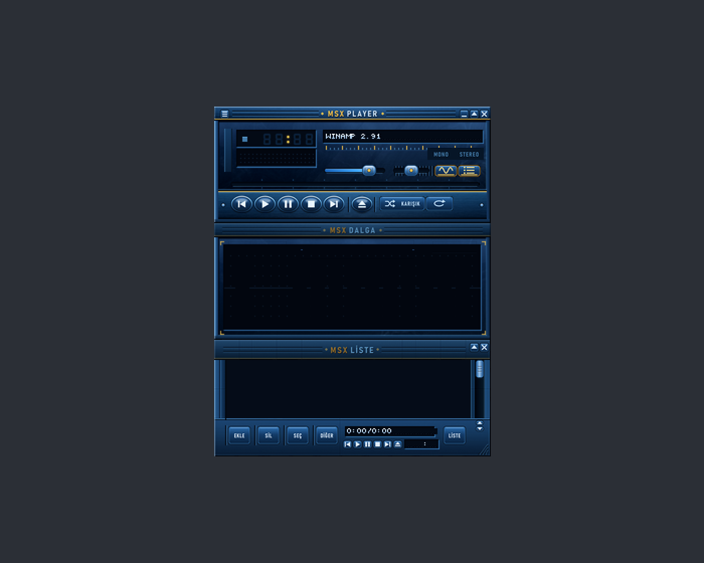

# MsXLabs Mavi Karanlık — klasik (Winamp 2 uyumlu) skin

**Türkçe** · [English below](#english)

Koyu lacivert zemin, altın vurgulu, tamamen **özgün çizilmiş** klasik `.wsz` skin. Winamp 2 skin biçimini destekleyen oynatıcılarda
(ör. [Webamp](https://webamp.org), Winamp 2.x/5.x uyumlu oynatıcılar) çalışır. Türkçe karakterler (ç ş ğ ı ü ö İ) metin
sprite'ında desteklenir; başlıklar "MSX PLAYER / MSX DALGA / MSX LİSTE", düğme etiketleri Türkçedir.

## Kurulum
- **Webamp / skins.webamp.org:** `msx-mavi-karanlik.wsz` dosyasını sayfaya sürükleyin ya da `initialSkin: { url }` verin.
- **Winamp 2 uyumlu oynatıcılar:** dosyayı `Skins` klasörüne kopyalayın, skin menüsünden seçin.
- **Yerel önizleme:** `onizleme/index.html` (yönerge dosya içinde; `webamp@2.3.1` MIT).

## Telif / özgünlük
Tüm bitmap'ler MsXLabs tarafından çizildi; Winamp, Nullsoft veya üçüncü taraf skin görseli içermez. "Winamp" adı yalnızca *biçim
uyumluluğunu* belirtmek için kullanılır; bu skin Winamp/Nullsoft/Webamp ile bağlantılı değildir ve onların onayını iddia etmez.
Görseller ve skin: MIT (bkz. `LICENSE`). Yazı tipi gömülü değil (bitmap).

## Lisans
MIT. Yapım: **MsXLabs — https://www.msxlabs.org**

---

## English
A fully **original** classic `.wsz` skin: deep navy with gold accents, Turkish-aware text sprites (ç ş ğ ı ü ö İ) and Turkish
button labels. Works in players that support the Winamp 2 skin format, e.g. [Webamp](https://webamp.org).

**Install:** drag `msx-mavi-karanlik.wsz` onto Webamp, or put it in your player's `Skins` folder and select it.
**Originality:** every bitmap was drawn by MsXLabs; no Winamp/Nullsoft or third-party skin artwork. "Winamp" appears only to
describe *format compatibility*; no affiliation or endorsement is claimed.
**License:** MIT — see `LICENSE`. By **MsXLabs — https://www.msxlabs.org**
